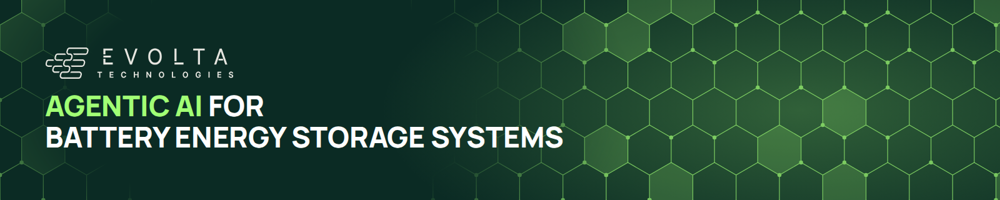

## Guillaume Tauzin

CTO at [Evolta Technologies](https://www.evolta-technologies.com), building agentic AI for battery energy storage systems, and founder of [stateful-y](https://stateful-y.io), open-source packages for end-to-end time-series systems. Machine learning scientist and engineer, working on time-series systems from exploration to production.

<a href="https://www.linkedin.com/in/gtauzin/"><picture><source media="(prefers-color-scheme: dark)" srcset="assets/btn-linkedin-dark.png"></picture></a> <a href="https://sigmoid.social/@gtauzin"><picture><source media="(prefers-color-scheme: dark)" srcset="assets/btn-mastodon-dark.png"></picture></a> <a href="https://stateful-y.io"><picture><source media="(prefers-color-scheme: dark)" srcset="assets/btn-stateful-y-dark.png"></picture></a>

<picture><source media="(prefers-color-scheme: dark)" srcset="assets/t-title-y-dark.png"></picture>

*Time-series forecasting with a scikit-learn API, and integrations for tuning, foundation models and serving.*

<a href="https://stateful-y.io/forecasting"><picture><source media="(prefers-color-scheme: dark)" srcset="assets/t-tile-y-dark.png"></picture></a>

<a href="https://github.com/stateful-y/yohou"><picture><source media="(prefers-color-scheme: dark)" srcset="assets/t-card-m-yohou-dark.png">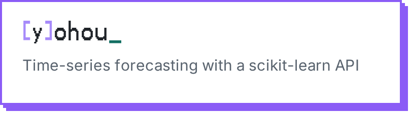</picture></a> <a href="https://github.com/stateful-y/yohou-optuna"><picture><source media="(prefers-color-scheme: dark)" srcset="assets/t-card-m-yohou-optuna-dark.png">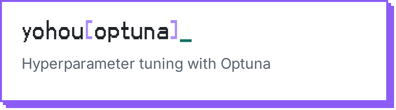</picture></a>

<a href="https://github.com/stateful-y/yohou-nixtla"><picture><source media="(prefers-color-scheme: dark)" srcset="assets/t-card-m-yohou-nixtla-dark.png">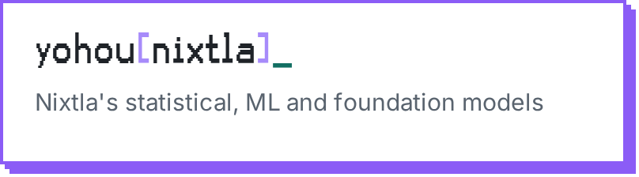</picture></a> <a href="https://github.com/stateful-y/yohou-mlflow"><picture><source media="(prefers-color-scheme: dark)" srcset="assets/t-card-m-yohou-mlflow-dark.png"></picture></a>

<picture><source media="(prefers-color-scheme: dark)" srcset="assets/t-title-k-dark.png"></picture>

*Run Kedro pipelines on the orchestrators and platforms teams already use.*

<a href="https://stateful-y.io/data-pipelines"><picture><source media="(prefers-color-scheme: dark)" srcset="assets/t-tile-k-dark.png"></picture></a>

<a href="https://github.com/stateful-y/kedro-dagster"><picture><source media="(prefers-color-scheme: dark)" srcset="assets/t-card-m-kedro-dagster-dark.png">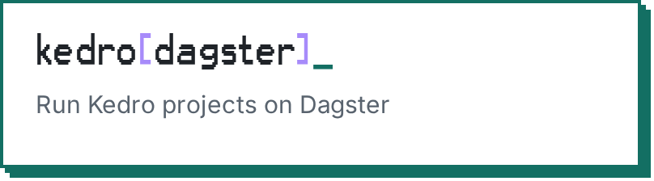</picture></a> <a href="https://github.com/stateful-y/kedro-azureml-pipeline"><picture><source media="(prefers-color-scheme: dark)" srcset="assets/t-card-m-kedro-azureml-pipeline-dark.png">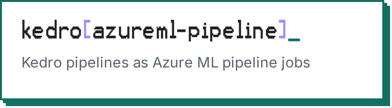</picture></a>

<picture><source media="(prefers-color-scheme: dark)" srcset="assets/t-title-a-dark.png"></picture>

*The template every stateful-y package starts from, and scikit-learn utilities that work without Yohou.*

<a href="https://github.com/stateful-y/sklearn-wrap"><picture><source media="(prefers-color-scheme: dark)" srcset="assets/t-card-m-sklearn-wrap-dark.png">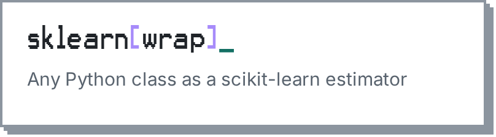</picture></a> <a href="https://github.com/stateful-y/sklearn-optuna"><picture><source media="(prefers-color-scheme: dark)" srcset="assets/t-card-m-sklearn-optuna-dark.png">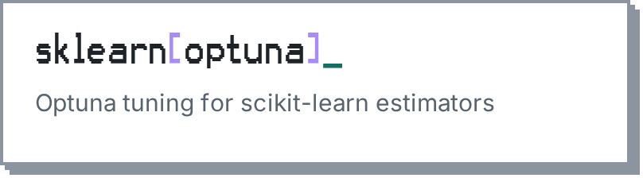</picture></a>

<a href="https://github.com/stateful-y/python-package-copier"><picture><source media="(prefers-color-scheme: dark)" srcset="assets/t-card-m-python-package-copier-dark.png">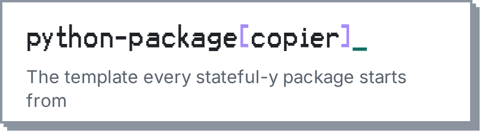</picture></a>

<picture><source media="(prefers-color-scheme: dark)" srcset="assets/t-title-earlier-dark.png"></picture>

<a href="https://github.com/giotto-ai/giotto-tda"><picture><source media="(prefers-color-scheme: dark)" srcset="assets/t-card-m-giotto-tda-dark.png"></picture></a> <a href="https://github.com/gtauzin/metaLBM"><picture><source media="(prefers-color-scheme: dark)" srcset="assets/t-card-m-metaLBM-dark.png">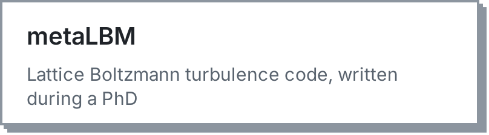</picture></a>

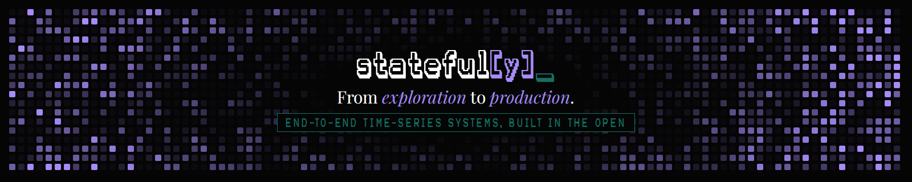
